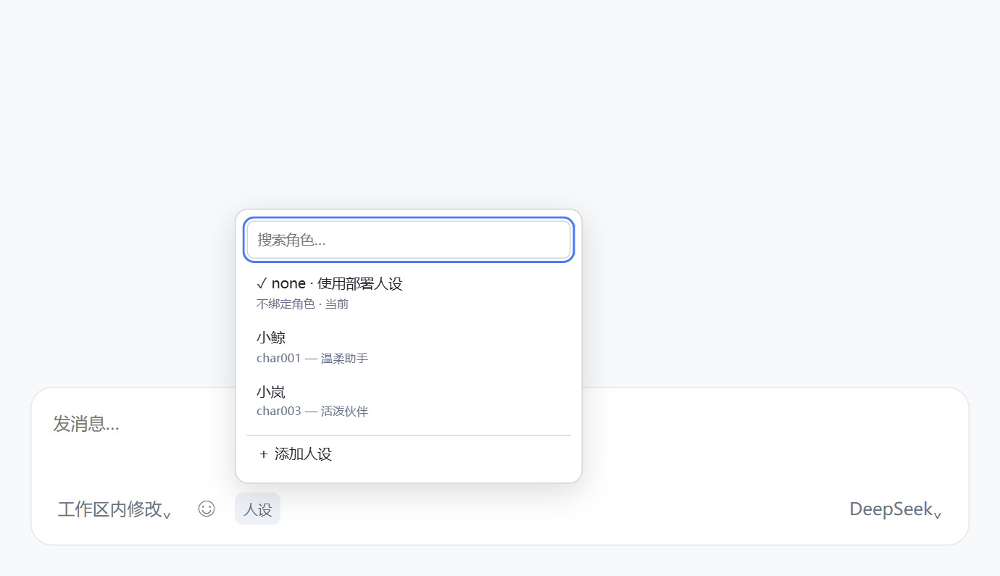

# 人设切换

> 0.3.1-toy.14：性能修订。人设选择器共用一条可取消的变更等待请求，取代固定间隔读取；隐藏页面与卸载时停止请求。后端无变化时最多等待 25 秒后续接，不重复读取角色库。旧宿主不支持该接口时降为 30 秒兜底。当前立绘模块仍不默认挂载，其历史轮询也一并移除。安装包见下方 GitHub 预发布附件。

> **在当前对话里换人设，下一次回复就按新的人设说话。**
> 切换不会更换模型、工具或权限。每个对话单独记住选择，重启后仍保留。

**目前仅适配 DSH 测试版 `0.2.1-rc.3-22ddee3`。** 沿用原版包名 `dsh-persona-switcher`。从 `dsh-toy-persona` 升级时，先备份 profile 配置、角色库与会话绑定，再停用旧包并安装本版，避免重复加载。保留 `persona-switcher` 配置键与原角色数据目录。

## 效果

点击输入框下方的「人设」，搜索或选择角色；也可以直接添加新人设。下图为示例角色。

设置页右上角的「新增角色」位于「打开配置文件」左侧，列表直接展示角色。设置页管理角色；选择或取消当前对话的人设统一在对话框底部的「人设」菜单完成。编辑已有角色时，可在右上角点击「设为默认」或「取消默认」，即时保存；角色库给默认角色显示「默认」小标记。默认仅作用于之后新建且没有已有选择的对话，旧对话保持原样。取消默认后，新对话沿用 DSH 的 Agent 预设。常规、诊断工具、立绘与屏幕挂件入口暂时隐藏；已有立绘数据和接口保留。

## 安装

**搭配 QQ 聊天界面安装时，请先关闭其他 UI 美化插件。** QQ 可能与其他皮肤、气泡或聊天布局插件冲突；安装后先确认界面正常，再按需逐个恢复。独立对话分段插件应停用，避免与 QQ 内置分段重复渲染。

检测到已启用的 Fish TTS 后，角色行显示「绑定音色」。点击后输入 Fish 音色 ID，可直接点击弹窗内的「试听」试听当前输入，再保存绑定；留空保存可解除绑定。角色编辑区只编辑人设文字，已有音色绑定会保留。角色库中的「设置头像」可绑定默认头像，QQ 会为首次采用它的对话保存头像，手动会话头像优先。详见[媒体设置与接口说明](docs/media-integration.md)。

检测到已启用且接口可用的 dsh-meme 后，角色行显示「表情偏好」，默认隐藏。可多选优先图库，自动汇总对应标签；选择发表情频率（跟随 dsh-meme、低频、适中、高频、不主动发），补充提示词并预览；清空后保存解除偏好。偏好跟随当前对话的人设；角色频率会在该会话中覆盖冲突的通用主动斗图建议，保留发送方式和渠道限制，不改 dsh-meme 插件或全局设置。当前 dsh-meme 无角色频率接口，频率和图库选择均为提示词偏好，需由模型执行；图库仍须在 dsh-meme 中启用。

下载 [v0.3.1-toy.14 发布附件](https://github.com/Oblivious0214/dsh-toy-persona/releases/tag/v0.3.1-toy.14) 中的 `dsh-persona-switcher-0.3.1-toy.14.tgz`，在 DSH 插件页通过本地安装包入口安装，完成后按提示重启。源码 ZIP 不用于安装；附件以 Release 实际发布为准。

维护分支：[feat/dsh-toy-persona](https://github.com/Oblivious0214/dsh-toy-persona/tree/feat/dsh-toy-persona)。完整改动与兼容范围见 [发布说明](RELEASE.md)。本分支通过 GitHub 附件分发，不向 npm 发布同名包；工作区迁移脚本不随公开包提供。

第一次使用：点输入框下方的 **人设 → 添加人设**，填写角色名称和人设内容，保存后选中即可。也可以从 **设置 → 人设切换** 管理角色、默认人设和可用的媒体偏好。

想取消当前人设，在对话框底部的人设菜单里选 **不使用角色**，恢复 DSH 当前 Agent 预设的人设。

## 致谢

插件管理页显示「人设切换 · Toy 分支」，设置与按钮保留「人设切换」「人设」。版本格式为 `上游主分支版本-toy.修订号`；本次基于上游 `0.3.1`（`5638544`），保留原本地 `0.3.2` 的人设切换与数据兼容。同一上游基础递增 Toy 修订号，合入新上游版本后从 `toy.1` 开始。

这是基于 [yupaoa/dsh-persona-switcher](https://github.com/yupaoa/dsh-persona-switcher) 继续修改的维护分支，感谢原作者提供的人设切换与立绘功能。保留原作者署名与 [MIT 许可证](LICENSE)。

同时感谢 [DeepSeek Harness](https://github.com/deepseek-ai/deepseek-harness) 提供人设与插件接口。

当前包名：`dsh-persona-switcher` · 版本：`0.3.1-toy.14` · [输入框适配记录](docs/composer-compatibility.md) · [历史与技术说明](docs/README.previous.md)
